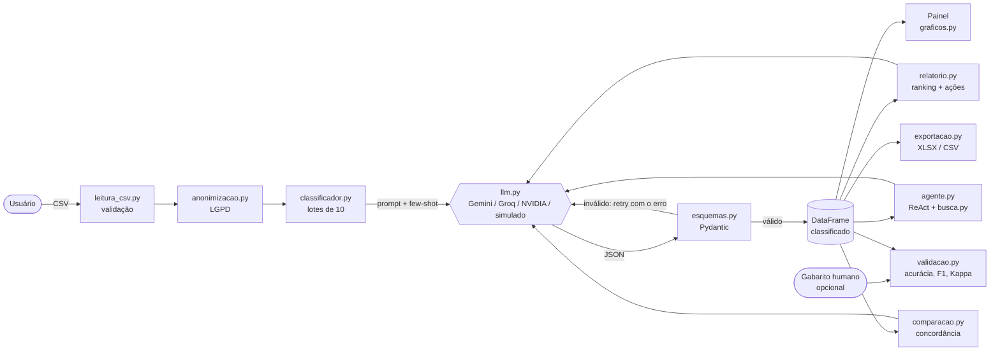
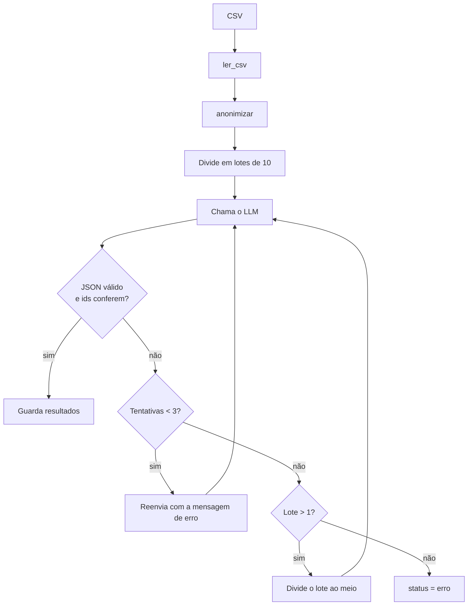
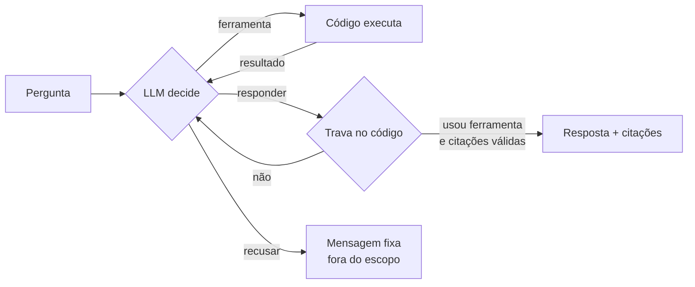
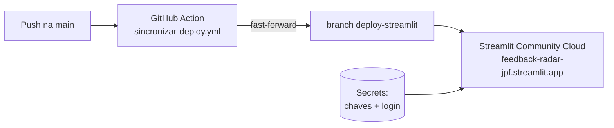

# Feedback Radar: arquitetura do projeto

Documento de apoio à apresentação, escrito a partir do código e da documentação do repositório (estado de 18/11/2026).

---

## 1. O que é

Projeto acadêmico de IA Generativa. O usuário envia um CSV de avaliações de clientes (Google, iFood, Instagram, e-commerce). Um LLM classifica cada avaliação em **sentimento**, **temas** e **intensidade**. Com isso o sistema gera:

- um **painel** (dashboard);
- um **relatório de prioridades de melhoria**, com citações reais dos clientes;
- um **agente analista**, que responde perguntas abertas investigando os dados em vários passos;
- uma **comparação de modelos** (Gemini × GPT-OSS/Groq × Nemotron/NVIDIA × regras).

Três ideias resumem o projeto:

1. O **código** faz as contas e valida tudo.
2. O **LLM** só interpreta texto e redige.
3. O **modelo é trocável**, porque o provedor fica isolado em um único módulo.

---

## 2. Visão geral



**Fluxo em uma frase:** CSV → limpeza → anonimização → lotes de 10 → LLM devolve JSON → validação (com retry se vier errado) → painel, relatório, agente e comparação.

---

## 3. Stack tecnológica

| Camada | Tecnologia | Por quê |
|---|---|---|
| Linguagem e dados | Python 3.11+, pandas | Leitura de CSV, filtros e agregações em poucas linhas |
| Interface | Streamlit (5 abas), tema em `.streamlit/config.toml` | Feito para dashboards de dados. Gradio serviria mais para demos de modelo |
| Gráficos | Plotly | Gráficos interativos |
| Validação | Pydantic | Rejeita JSON fora do formato e tema fora da taxonomia |
| LLM principal | Google Gemini `gemini-3.5-flash-lite` (`google-genai`) | Plano gratuito, bom em português, aceita saída em JSON |
| LLMs de comparação | Groq (`openai/gpt-oss-120b`) e NVIDIA (`nvidia/nemotron-3.5-bolt-e4b`) via `httpx` | Mesma API do formato OpenAI, então um cliente só atende os dois |
| Busca semântica | `gemini-embedding-001`, com TF-IDF (scikit-learn) de reserva | Recuperação de avaliações por sentido |
| Exportação | openpyxl (XLSX), fpdf2 (PDF) | Planilha formatada, CSV com `;` e relatório em PDF |
| Config e segredos | `python-dotenv`, `st.secrets`, `Authlib` (login Google) | Chaves nunca vão para o git |
| Testes | pytest (`tests/`, quatro arquivos) | Rodam sem chamar a API |
| Deploy | Streamlit Community Cloud + GitHub Action | Ver seção 9 |

---

## 4. Estrutura de pastas

```
feedback-radar/
├── app.py                  # só interface (434 linhas); nenhuma regra de negócio
├── feedback_radar/         # núcleo, usado pelo app, scripts e testes
├── scripts/                # linha de comando (lote, conversão, rotulagem, avaliação)
├── tests/                  # pytest: pipeline, agente, comparação, app
├── data/
│   ├── exemplos/           # CSV fictício para demonstração
│   ├── b2w_500.csv         # amostra do B2W-Reviews01 (dados reais públicos)
│   ├── rotulagem/          # planilhas de rotulagem manual (2 duplas)
│   └── exploracao/         # comparação com chats (ChatGPT, Claude, Gemini web)
├── resultados/             # saídas já medidas (comparação, agente, concordância)
├── docs/                   # etapas 1 a 9, deploy, LGPD, relatório PDF/DOCX
├── .streamlit/             # tema e modelo de secrets
└── .github/workflows/      # sincronizar-deploy.yml
```

**Princípio central:** `app.py` só desenha a tela. Toda a lógica fica em `feedback_radar/`. Assim o mesmo código serve ao dashboard, aos scripts e aos testes, e o grupo de 5 pessoas consegue dividir o trabalho.

---

## 5. Módulos do núcleo (`feedback_radar/`)

| Módulo | Responsabilidade |
|---|---|
| `config.py` | Todas as configurações. Ordem de leitura: `st.secrets` → `.env` → padrão no código |
| `login.py` | `exigir_login()` roda antes do app. Login Google com lista de e-mails (`[auth]` + `EMAILS_PERMITIDOS`) ou senha (`SENHA_APP`). Sem nenhum dos dois o app fica **bloqueado** |
| `leitura_csv.py` | Detecta encoding (UTF-8, cp1252, latin-1) e separador. Aceita sinônimos de coluna. Remove vazias e duplicadas. Valida nota e data |
| `anonimizacao.py` | Regex para e-mail, telefone, CPF, links, `@perfil` e nomes depois de cargo |
| `taxonomia.py` | Os 7 temas fixos (atendimento, preço, demora, qualidade_produto, limpeza_ambiente, pedido_entrega, outros) e os 3 sentimentos |
| `prompts.py` | Prompts de classificação (com few-shot), de relatório e de agente |
| `esquemas.py` | Modelos Pydantic: `Classificacao`, `RespostaLote`, `RespostaRelatorio`, `Prioridade`, `AcaoAgente` |
| `llm.py` | `ClienteGemini`, `ClienteOpenAICompativel` (Groq e NVIDIA) e `ClienteSimulado`, mais a fábrica `criar_cliente()` |
| `classificador.py` | Lotes, retry, divisão de lote ao meio, estimativa de custo e `Estatisticas` |
| `relatorio.py` | Ranking de impacto, relatório em Markdown e PDF |
| `agente.py` | Laço ReAct, 4 ferramentas e travas anti-alucinação |
| `busca.py` | `IndiceBusca`: embeddings por similaridade de cosseno, com TF-IDF de reserva |
| `comparacao.py` | Classifica com vários modelos e calcula a concordância entre eles |
| `validacao.py` | Métricas IA × gabarito: acurácia, F1, Kappa, Jaccard dos temas e hipóteses de erro |
| `graficos.py` | Gráficos Plotly (sentimento, temas, evolução, matrizes) |
| `exportacao.py` | XLSX formatado e CSV com `;` para o Excel brasileiro |

---

## 6. Os quatro fluxos principais

### 6.1 Classificação (a base de tudo)



- **O erro volta para o modelo.** O Pydantic produz uma mensagem clara e ela é reenviada no retry.
- **O lote problemático é dividido ao meio.** Isso isola a avaliação que sempre falha, e as outras são salvas.
- **O sistema degrada, mas não quebra.** Cota diária esgotada guarda o que já foi classificado e marca o resto como `erro`. Erro 503 ou timeout (60 s) aciona o modelo reserva. Erros 400, 403 e 404 param na hora com mensagem clara.

Saída: DataFrame com `sentimento`, `temas`, `intensidade`, `resumo_curto`, `status` e `texto_enviado` (anonimizado).

### 6.2 Relatório de prioridades: o código manda, o LLM redige

```
impacto = frequência do tema × % de menções negativas × (intensidade média das negativas ÷ 5)
```

1. O **código** calcula o ranking e escolhe exemplos reais.
2. O **LLM** só escreve diagnóstico e 3 a 5 ações por tema, citando `ids_exemplos`.
3. O **código** valida os ids e insere o texto **original** da avaliação. O LLM nunca "cita" um cliente com as próprias palavras.
4. Saída em Markdown e PDF.

### 6.3 Agente analista (ReAct + RAG)



| Ferramenta | O que faz |
|---|---|
| `buscar_avaliacoes` | Busca semântica (a parte de recuperação do RAG), com filtros de sentimento, tema e período |
| `contar` | Agrupa por sentimento, tema, mês, fonte ou nota, e calcula a nota média |
| `ranking_impacto` | Reaproveita a fórmula do relatório |
| `comparar_periodos` | Compara dois intervalos de datas |

**Travas anti-alucinação:**

- Limite de 6 passos (`AGENTE_MAX_PASSOS`).
- Toda resposta exige pelo menos **uma ferramenta usada**. É regra do código, não do prompt.
- Citar um id que o modelo nunca recebeu faz a resposta ser **rejeitada**.
- O texto mostrado nas citações é sempre o original.
- Argumentos inválidos viram mensagem de erro para o modelo corrigir, em vez de quebrar o programa.
- Fora do escopo (ex.: "O que é Python?"): o modelo usa a ação `recusar` e o **código** escreve a resposta fixa.
- Memória: as 3 últimas trocas entram no prompt.
- A tela mostra "Como a IA chegou nisso", com cada passo auditável.

### 6.4 Comparação de modelos

As mesmas avaliações passam por cada provedor (`classificar_com_modelos`). Depois `concordancia()` calcula a concordância de sentimento entre cada par de modelos, a concordância de temas (Jaccard médio) e a lista de avaliações em que os modelos divergem, que são as ambíguas.

**Ressalva:** concordar não é acertar. Só o gabarito humano mede acerto; com ele, `acuracia_por_modelo()` calcula acurácia, F1, Kappa e recall de negativos.

**Resultado medido** (100 avaliações reais do B2W, 31/10/2026, com o MiniMax como modelo da NVIDIA, depois trocado pelo Nemotron Bolt):

| Dado | Resultado |
|---|---|
| Os 3 modelos de empresas diferentes deram o mesmo sentimento | 93 de 100 |
| Concordância de sentimento entre as IAs | 0,93 a 0,96 |
| Concordância de sentimento entre IA e regras por palavras-chave | 0,71 a 0,75 |
| Concordância de temas entre as IAs (Jaccard) | 0,79 a 0,82 |
| Concordância de temas entre IA e regras (Jaccard) | 0,37 |
| Causa das 7 divergências | Avaliações **mistas** (elogio e crítica juntos) |

Os tempos dessa tabela (por exemplo 198 s da NVIDIA) são do MiniMax. Os resultados do Nemotron Bolt estão em `docs/comparacao-modelos.md`.

---

## 7. Decisões técnicas para defender

| Decisão | Justificativa |
|---|---|
| **Taxonomia fechada** de 7 temas | Permite contar, comparar, validar automaticamente e medir contra o gabarito |
| **Lotes de 10** | Uma chamada por avaliação gastaria a cota gratuita. Lotes grandes fazem o modelo pular itens |
| **Temperatura 0** e saída em JSON | Respostas estáveis e fáceis de validar |
| **Pydantic + retry com o erro** | Validar formato é barato e corrige a maioria das falhas |
| **Código calcula, LLM redige** | Todos os números vêm de código, o que reduz a alucinação |
| **Provedor isolado em `llm.py`** | O `gemini-2.5-flash` foi descontinuado durante o projeto e o `llama-3.3-70b` do Groq já não existia. Trocar de modelo exige mudar só o `.env` |
| **Modo simulado** | Todos testam sem chave. Também serve de linha de base |
| **Núcleo separado da interface** | Testável e reutilizável por app, CLI e scripts |
| **Modelo reserva** (`GEMINI_MODELO_RESERVA`) | Em 26/10 o modelo principal levou mais de 3 minutos para uma chamada trivial |
| **Anonimização ligada por padrão** | LGPD. No plano gratuito o Google pode usar o conteúdo para melhorar seus produtos |

**Custo:** cerca de US$ 0,0003 a 0,0004 por avaliação no plano pago, ou US$ 0,30 a 0,40 por 1.000. O app estima o custo antes de classificar e contabiliza o real depois.

---

## 8. Interface (as 5 abas de `app.py`)

| Aba | O que faz |
|---|---|
| **Dados** | Upload do CSV, avisos de limpeza, estimativa de custo, botão Classificar, download em XLSX ou CSV. Um CSV já classificado é carregado sem gastar chamadas |
| **Painel** | Métricas, sentimento, temas, evolução no tempo, tabela filtrável |
| **Prioridades** | Gera o relatório e baixa em MD ou PDF |
| **Analista** | Chat com o agente, com os passos auditáveis |
| **Comparação de modelos** | Roda vários provedores, mostra matrizes de concordância e divergências. Tem gabarito humano opcional |

O estado fica em `st.session_state` e os arquivos enviados **não são gravados**: ficam só na memória da sessão. A barra lateral escolhe o provedor.

---

## 9. Segurança, privacidade e deploy

- **Acesso:** o login roda antes de qualquer outra coisa. Não deixe `LOGIN_DESATIVADO=1` nos Secrets do Cloud.
- **Segredos:** chaves em `.env` ou nos Secrets do Streamlit, ambos no `.gitignore`.
- **Dados reais:** ficam em `data/privado/` (ignorada pelo git). Só dados públicos (B2W) e fictícios vão para o repositório.



O Streamlit Cloud não permite trocar a branch de um app existente. A Action mantém a `deploy-streamlit` igual à `main` a cada push, só avançando (fast-forward), então não apaga commits feitos direto na branch por engano.

**Riscos conhecidos** (`docs/deploy.md`): todos os usuários dividem a mesma chave e cota; o servidor do Streamlit fica fora do Brasil; não há separação de dados por negócio; o app hiberna depois de alguns dias sem uso.

---

## 10. Validação, testes e scripts

**Validação humana (opcional, em andamento):** 100 avaliações reais do B2W; 2 duplas rotulam as mesmas avaliações, separadas, e a quinta pessoa desempata. `montar_gabarito.py` consolida o gabarito e `avaliar_validacao.py` mede IA × gabarito.

| Script | Função |
|---|---|
| `classificar_cli.py` | Classificar e gerar relatório pela linha de comando |
| `converter_dataset.py` | Converter Olist ou B2W para o formato do projeto |
| `gerar_planilha_rotulagem.py` | Sortear e montar a planilha de rotulagem |
| `dividir_rotulagem.py` | Criar um arquivo por pessoa |
| `montar_gabarito.py` | Consolidar o gabarito |
| `avaliar_validacao.py` | Medir IA × gabarito |
| `avaliar_agente.py` | Rodar 8 perguntas fixas contra o agente |
| `comparar_ferramentas.py` | Comparar com os chats (ChatGPT, Claude, Gemini web) |
| `exportar_prompts.py` | Gerar o apêndice dos prompts |

**Resultado do agente** (8 perguntas sobre as 100 avaliações reais, `gemini-3.5-flash-lite`):

| Métrica | Resultado |
|---|---|
| Perguntas respondidas | 8 de 8 |
| Chamadas por pergunta | 3,2 em média |
| Citações rejeitadas | 0 |
| Custo total (equivalente no plano pago) | US$ 0,037 |
| Números das respostas | Conferidos contra os dados e corretos |
| Pergunta sobre assunto ausente | O agente disse que não havia dados |
| Falha encontrada | Na pergunta do banheiro, acrescentou uma sugestão genérica sem base nos dados |

**Testes** (`tests/`): pipeline, agente, comparação e abertura do app. Todos rodam com o provedor simulado, sem chamar a API.

---

## 11. Limitações (diga antes que perguntem)

- Concordância entre modelos não prova acerto. Falta o gabarito humano completo.
- Avaliações **mistas** são a principal fonte de divergência. A regra 2 do prompt continua ambígua na prática.
- A anonimização por regex é incompleta (ex.: "a Ju do caixa").
- O `resumo_curto` pode alucinar, por isso não entra em nenhuma decisão.
- A validação garante o **formato**, não a correção do conteúdo.
- O agente pode escolher ferramentas ruins ou parar cedo. O limite de passos evita laço infinito, mas não garante a melhor investigação.
- A busca devolve no máximo 15 avaliações por chamada. Perguntas sobre "todas" dependem de `contar`.
- Os datasets abertos são de e-commerce, então o tema `limpeza_ambiente` quase não aparece.
- No plano gratuito, a cota diária é baixa, o que dá poucas perguntas por dia ao agente.

**Caminho para virar produto** (`docs/aplicacao-pratica.md`): piloto com 2 ou 3 negócios; histórico por negócio em banco de dados, contas de usuário e classificação sem repetição; coleta automática via Google Business Profile API; plano pago da API e adequação à LGPD antes de cobrar de alguém.

---

## 12. Pendências do grupo (README)

1. Opcional: rotular as 100 avaliações para medir o acerto de cada modelo.
2. Gravar o vídeo da Parte 2.
3. Ensaiar a apresentação.
4. Colar `GROQ_API_KEY` e `NVIDIA_API_KEY` nos Secrets do Streamlit e reiniciar o app. Sem isso, a aba de comparação não funciona no app publicado.
