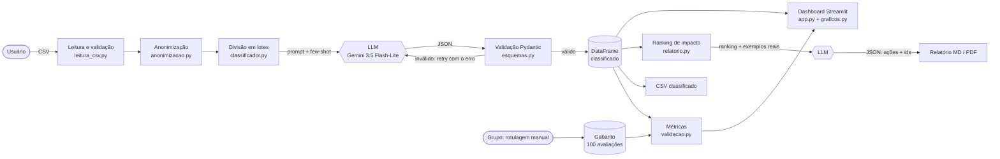

# Etapa 1 — Arquitetura e estrutura de pastas

## Visão geral



## Fluxo em uma frase

CSV → limpeza → anonimização → lotes de 10 avaliações → LLM devolve JSON → validamos (e repetimos se vier errado) → dashboard, relatório e métricas de validação.

## Estrutura de pastas

```
feedback-radar/
├── app.py                 # interface (só tela; nenhuma regra de negócio aqui)
├── feedback_radar/        # "núcleo": pode ser usado pelo app, pelos scripts e pelos testes
├── scripts/               # tarefas de linha de comando (lote, conversão, validação)
├── tests/                 # testes automatizados com pytest
├── data/exemplos/         # dados fictícios versionados
├── data/rotulagem/        # modelo da planilha de rotulagem
├── data/privado/          # dados reais (NÃO vai para o git)
├── saidas/                # resultados gerados (NÃO vai para o git)
└── docs/                  # documentação das etapas
```

## Decisões técnicas (para defender na apresentação)

| Decisão | Por quê |
|---|---|
| **Python + pandas** | Linguagem que o grupo já conhece; pandas resolve leitura de CSV, filtros e agregações em poucas linhas. |
| **Google Gemini 3.5 Flash-Lite** (API; antes 2.5 Flash e 3.8 Flash) | Tem **plano gratuito** sem cartão de crédito (Google AI Studio), entende bem português, aceita resposta em JSON (`response_mime_type`). No teste real, o custo equivalente no plano pago ficou abaixo de US$ 0,001 por avaliação (ver Etapa 3; confira os preços atuais). O `gemini-2.5-flash` foi descontinuado para contas novas durante o projeto, o que mostra o risco de depender de um fornecedor: o modelo é configurável no `.env`. |
| Alternativas consideradas | **Groq** (gratuito, modelos Llama, muito rápido, mas limites e modelos mudam com frequência); **Ollama** (roda local, grátis e privado, mas exige PC com boa memória e é mais lento); **OpenAI/Claude** (ótima qualidade, mas sem plano gratuito de API). O código isola o provedor em `llm.py`, então trocar é só criar uma classe nova. |
| **Streamlit** em vez de Gradio | Streamlit foi feito para *dashboards de dados*: abas, cards de métricas (`st.metric`), tabelas filtráveis, upload e download, gráficos Plotly — tudo nativo. Gradio é ótimo para *demos de modelo* (entrada → saída) e para publicar no Hugging Face Spaces, mas montar um dashboard com várias visões dá mais trabalho. |
| **Plotly** | Gráficos interativos (passar o mouse, zoom) com uma linha de código. |
| **Pydantic** para validar o JSON | O LLM pode errar o formato. O Pydantic verifica tipos, valores permitidos e a taxonomia, e devolve uma mensagem de erro clara que reenviamos ao modelo. |
| **Lotes de 10 avaliações** | Uma chamada por avaliação gastaria muito da cota gratuita (limite de requisições por minuto/dia) e repetiria o prompt longo de instruções. Lotes muito grandes aumentam a chance de o modelo "pular" itens. 10 é um meio-termo; é configurável. |
| **Modo "simulado"** | Permite que todo o grupo rode e teste o sistema sem chave de API, e serve como **linha de base** (baseline) na validação. |
| **Núcleo separado da interface** | A mesma lógica é usada no dashboard, nos scripts e nos testes. Facilita testar e dividir o trabalho entre 6 pessoas. |

## Sugestão de divisão do trabalho (6 pessoas)

| Pessoa | Responsabilidade |
|---|---|
| 1 | Leitura de CSV, anonimização, coleta de dados reais (autorização/LGPD) |
| 2 | Taxonomia e engenharia de prompt (testar variações) |
| 3 | Pipeline de classificação, custo e testes automatizados |
| 4 | Dashboard (Streamlit + gráficos) |
| 5 | Relatório de prioridades e exportação |
| 6 | Coordenação da rotulagem manual, métricas e análise de erros |

Todos participam da rotulagem (2 rotuladores por avaliação).

## Registro de uso de IA

A arquitetura, o diagrama Mermaid, a estrutura de pastas e a comparação entre provedores e entre Streamlit e Gradio foram gerados por um assistente de IA (Claude, da Anthropic) a partir do enunciado do grupo. Precisa de revisão humana: conferir se os preços e limites do plano gratuito do Gemini continuam valendo na data da entrega (eles mudam com frequência; ver https://ai.google.dev/pricing), validar se a divisão de tarefas combina com as habilidades reais de cada integrante e confirmar se o professor aceita o uso de uma API externa.
