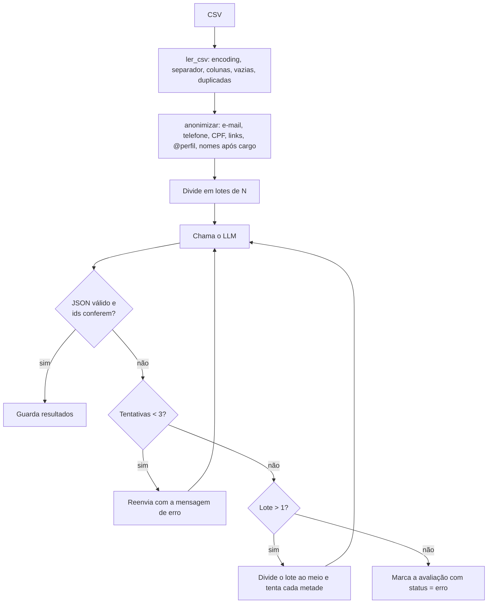

# Etapa 3 — Pipeline de classificação

Código: [`feedback_radar/classificador.py`](../feedback_radar/classificador.py), [`feedback_radar/leitura_csv.py`](../feedback_radar/leitura_csv.py), [`feedback_radar/anonimizacao.py`](../feedback_radar/anonimizacao.py), [`feedback_radar/llm.py`](../feedback_radar/llm.py)

## Passo a passo



## Tratamento de erros

| Problema | Como tratamos |
|---|---|
| CSV salvo no Excel (Windows-1252) | tenta UTF-8, depois cp1252 e latin-1 |
| Separador `;` | `sep=None` detecta automaticamente |
| Coluna "Comentário" em vez de "texto" | tabela de sinônimos |
| Coluna `texto` ausente | erro claro, listando as colunas encontradas |
| Linhas vazias / duplicadas | removidas, com aviso |
| Nota fora de 1–5, data inválida | ignoradas, com aviso |
| Texto enorme | cortado em 1000 caracteres (custo) |
| JSON quebrado ou com markdown (` ```json `) | `extrair_json` limpa; se falhar, retry |
| Sentimento/tema inventado | Pydantic rejeita → retry com o erro |
| Modelo "esquece" uma avaliação do lote | conferência de ids → retry |
| Erro de rede ou limite (HTTP 429) | espera exponencial (5 s, 10 s, 20 s; mínimo 30 s para 429) |
| Servidor sobrecarregado (503) ou lento demais | tempo limite de 60 s por chamada; o modelo reserva (`GEMINI_MODELO_RESERVA`) responde no lugar |
| Modelo descontinuado, chave inválida (400, 403, 404) | para na hora com mensagem clara, sem repetir |
| Cota diária gratuita esgotada | para na hora, guarda o que já foi classificado e marca o resto como `erro`; `classificar_cli.py --continuar` retoma depois |
| Modelo que não aceita desligar o raciocínio (ex.: os "lite") | o cliente percebe o erro 400 e repete sem essa opção |
| Datas em formato ISO (`2018-04-12`) ou brasileiro (`12/04/2018`) | o formato é detectado; antes, ISO era lido como dia/mês |
| Uma avaliação sempre falha | divisão do lote isola o problema; as outras são salvas |

## Controle de custo e tempo

- **Estimativa antes de rodar** (`estimar_custo`): nº de chamadas, tokens e custo em US$ se fosse plano pago. O app mostra isso antes do botão "Classificar"; a linha de comando pede confirmação.
- **Contabilidade real** (`Estatisticas`): chamadas, retries, tokens de entrada/saída lidos da resposta da API, tempo total.
- **Teto por execução**: `MAX_AVALIACOES=500` no `.env`.
- **Pausa entre chamadas**: `PAUSA_ENTRE_CHAMADAS=6` s, para respeitar o limite de requisições por minuto do plano gratuito.
- **Não reclassificar**: se você enviar um CSV já classificado, o app carrega direto, sem gastar chamadas.

### Custo por avaliação (estimativa)

Execução real com o CSV de exemplo (43 avaliações, lotes de 10, `gemini-3.8-flash`, 21/10/2026): 5 chamadas + 2 retries (erro 503 de sobrecarga do Google, recuperado automaticamente), o que equivale, no plano pago, a **~US$ 0,0003 a 0,0004 por avaliação**; 1.000 avaliações custariam ~US$ 0,30 a 0,40 (menos de R$ 2,50).

Preços oficiais do `gemini-3.8-flash` no plano pago (consultados em 21/10/2026 em https://ai.google.dev/gemini-api/docs/pricing): **US$ 0,75** por milhão de tokens de entrada e **US$ 3,75** de saída (incluindo tokens de raciocínio) até 31/12/2026, **dobrando** para US$ 1,50 / US$ 7,50 a partir de 01/01/2027. O plano gratuito continua sem custo, mas a mesma tabela informa que, nele, o conteúdo enviado **é usado para melhorar os produtos do Google** (no pago, não). Existe ainda o modo *Batch* (processamento em lote assíncrono), pela metade do preço, mas sem plano gratuito. No plano gratuito o custo é zero, mas há limite diário de requisições: com lotes de 10, 500 avaliações = 50 chamadas.

> A estimativa usa "~4 caracteres por token", o que é aproximado. O valor real aparece depois da execução (tokens informados pela API).

## Como rodar

```bash
python scripts/classificar_cli.py data/exemplos/avaliacoes_exemplo.csv --provedor simulado
python scripts/classificar_cli.py data/exemplos/avaliacoes_exemplo.csv            # Gemini
```

Saída: `saidas/avaliacoes_classificadas.csv` com as colunas originais + `texto_enviado` (anonimizado), `sentimento`, `temas` (separados por `;`), `intensidade`, `resumo_curto`, `status`.

## Riscos desta etapa

- **Alucinação no resumo:** o `resumo_curto` pode conter algo que não está no texto. Mitigação: instrução explícita e revisão por amostragem. Não usamos o resumo para decisões.
- **Validação garante formato, não correção:** um JSON perfeito pode trazer o sentimento errado. Por isso existe a Etapa 6.
- **Anonimização incompleta:** regex não pega todos os nomes (ex.: "a Ju do caixa"). Revise amostras de dados reais.
- **Vazamento de dados:** todo texto enviado sai do computador e vai para os servidores do Google.

## Registro de uso de IA

O código do pipeline (leitura, anonimização, lotes, retry, divisão de lote e estimativa de custo) foi gerado por IA (Claude) e testado com o provedor simulado e com testes automatizados (`pytest`, 9 testes passando). **Não foi testado com uma chave real do Gemini** durante a geração: o grupo precisa rodar ao menos uma vez com a API real e conferir o nome do modelo, os tokens contabilizados e o comportamento com o limite do plano gratuito. Também é necessário revisar as expressões regulares de anonimização com dados reais, porque elas foram escritas a partir de exemplos inventados.
