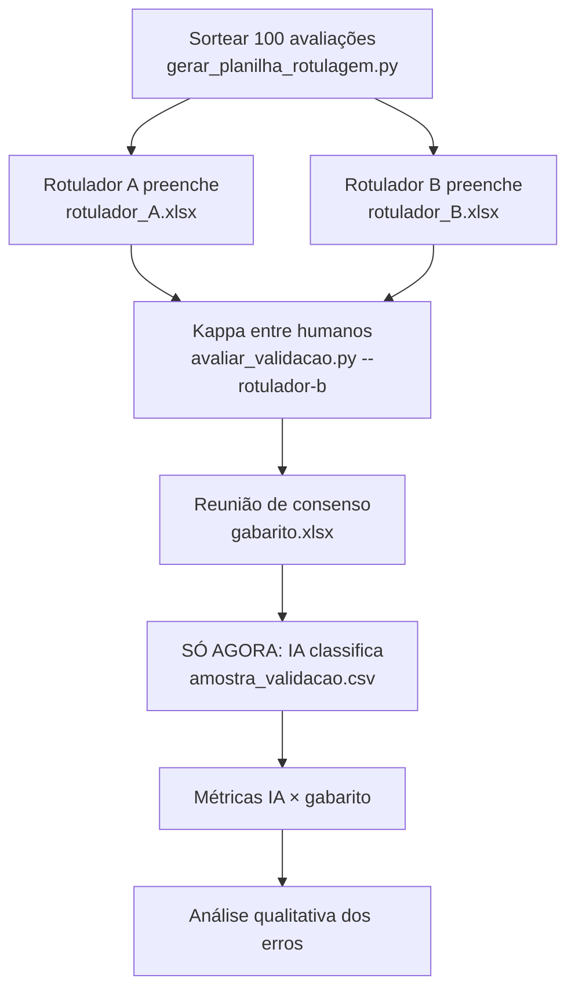

# Etapa 6 — Validação contra a classificação manual

Código: [`feedback_radar/validacao.py`](../feedback_radar/validacao.py), [`scripts/gerar_planilha_rotulagem.py`](../scripts/gerar_planilha_rotulagem.py), [`scripts/avaliar_validacao.py`](../scripts/avaliar_validacao.py), aba 4 do dashboard.

## Protocolo (siga nesta ordem)



```bash
# 1. Sortear e gerar a planilha (semente fixa = sorteio reprodutível)
python scripts/gerar_planilha_rotulagem.py data/olist_500.csv --n 100

# 2. Copiar data/rotulagem/planilha_rotulagem.xlsx para rotulador_A.xlsx, rotulador_B.xlsx...
#    (com 6 pessoas: 3 duplas, cada dupla rotula ~33 avaliações)

# 3. Concordância entre humanos
python scripts/avaliar_validacao.py --gabarito data/rotulagem/rotulador_A.xlsx --rotulador-b data/rotulagem/rotulador_B.xlsx

# 4. Depois do consenso, classificar a amostra com a IA
python scripts/classificar_cli.py data/rotulagem/amostra_validacao.csv --saida saidas/amostra_classificada.csv

# 5. Métricas
python scripts/avaliar_validacao.py --gabarito data/rotulagem/gabarito.xlsx --ia saidas/amostra_classificada.csv
```

## A planilha de rotulagem

`data/rotulagem/planilha_rotulagem.xlsx` tem 3 abas:

- **instrucoes:** regras anti-viés (abaixo) e como preencher;
- **temas:** definição de cada tema (as mesmas do prompt);
- **rotulagem:** `id`, `texto`, `sentimento` (lista suspensa), uma coluna `tema_*` por tema (marcar "x"), `intensidade` (1–5), `duvida` (sim/não), `observacoes`.

### Cuidados contra viés

1. **Rotular antes de rodar a IA** e nunca olhar a resposta dela (viés de ancoragem: tendemos a concordar com o que já vimos).
2. **Dois rotuladores independentes** por avaliação, sem conversar durante a rotulagem.
3. **A nota (estrelas) foi removida da planilha:** a IA também não vê a nota, então a comparação é justa.
4. **Ordem embaralhada** e pausas a cada ~30 avaliações (cansaço reduz a qualidade).
5. **Definições escritas** dos temas, iguais às do prompt.
6. **Amostra separada:** essas 100 avaliações não podem ser usadas como exemplos few-shot nem para ajustar o prompt. Se o prompt for ajustado olhando os erros, a métrica passa a ser otimista; nesse caso, sorteie uma nova amostra para a medição final.

## Métricas

### Sentimento (3 classes)

| Métrica | O que responde |
|---|---|
| **Acurácia** | % de avaliações em que a IA concordou com o gabarito |
| **Precisão por classe** | quando a IA disse "negativo", quantas vezes estava certa? |
| **Recall por classe** | das avaliações realmente negativas, quantas a IA encontrou? |
| **F1 por classe / F1 macro** | equilíbrio entre precisão e recall; o macro dá o mesmo peso às 3 classes (importante porque "neutro" costuma ser minoria) |
| **Matriz de confusão** | quais classes a IA confunde (ex.: neutro ↔ negativo) |
| **Kappa de Cohen** | concordância descontando o acaso. < 0,4 fraca, 0,4–0,6 moderada, 0,6–0,8 substancial, > 0,8 quase perfeita |

**Para o negócio, o recall da classe negativa é a métrica mais importante:** uma reclamação não detectada é um problema que o dono não vai ver.

### Temas (multirrótulo: uma avaliação pode ter vários)

| Métrica | O que responde |
|---|---|
| **Precisão / recall / F1 por tema** | a IA marca "demora" quando não devia? Deixa de marcar quando devia? |
| **Jaccard médio** | temas em comum ÷ temas no total (ex.: humano {demora, qualidade}, IA {demora} → 0,5) |
| **Acerto exato** | % de avaliações com conjunto de temas idêntico (métrica rigorosa) |

### O "teto" humano

O Kappa entre dois humanos mostra quão difícil é a tarefa. Se os humanos concordam em 85%, não faz sentido esperar 95% da IA. Compare a IA com esse teto e com o **modo simulado** (regras por palavras-chave), que funciona como linha de base: a IA precisa ser claramente melhor que ele.

## Análise de erros

O script gera `saidas/validacao/analise_de_erros.csv` com cada divergência e uma **hipótese automática** (pistas detectadas por regex):

| Pista | Exemplo |
|---|---|
| possível ironia/sarcasmo | "Parabéns, esperei só 50 minutos" |
| gíria/abreviação | "zuado demais", "mó brisa", "dms" |
| avaliação mista | "Comida boa, **mas** demorou" |
| texto muito curto | "Bom." |
| emoji carrega o sentido | "Chegou 👍" / "Chegou 🙄" |
| ambígua ou outro motivo | analisar manualmente |

A coluna `hipotese_do_grupo` fica vazia para o grupo preencher. As pistas automáticas são **apenas sugestões**: o relatório deve trazer a análise humana, de preferência com uma tabela "tipo de erro × quantidade" e 3 a 5 exemplos comentados.

Perguntas para a análise:

- Os erros se concentram em alguma classe? (é comum a IA "fugir" do neutro)
- Em quantos erros o próprio grupo teve dúvida ou discordou na rotulagem? Se forem muitos, o problema pode ser a ambiguidade da avaliação, não a IA.
- Algum tema é sistematicamente confundido com outro? Isso pode indicar uma definição ruim na taxonomia.

## Registro de uso de IA

O protocolo, a planilha, as métricas e as heurísticas de hipótese de erro foram gerados por IA (Claude). As fórmulas foram verificadas por um teste automatizado com um caso calculado à mão (acurácia de 75%, um erro de ironia detectado), e o script foi executado de ponta a ponta com rótulos aleatórios só para testar o fluxo. Revisão humana necessária: a rotulagem em si (é o gabarito, não pode ser feita pela IA), a análise qualitativa dos erros e a interpretação das métricas. As heurísticas de ironia e gíria são listas de palavras simples e vão errar; o grupo deve tratá-las como pistas e não como conclusões.
