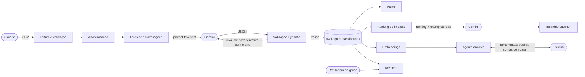

# Rascunho do relatório acadêmico

> Rascunho. O que está entre [colchetes] depende de medições e experiências do grupo e deve ser preenchido com resultados reais. Não entreguem números que não mediram. A estrutura segue as cinco seções pedidas no enunciado.

---

# Feedback Radar: classificação de avaliações de clientes com IA generativa para apoio à decisão em pequenos negócios

Integrantes: [nomes] · Disciplina: [nome] · Professor(a): [nome] · Data: [data]

## 1. Descrição da aplicação

Pequenos negócios recebem dezenas de avaliações por semana no Google, no iFood e no Instagram, mas raramente têm tempo ou método para transformá-las em decisões. O dono lê algumas, se irrita com outras e não sabe dizer qual problema é o mais frequente nem se ele está melhorando.

O Feedback Radar é uma aplicação web que recebe um arquivo CSV com as avaliações e usa um modelo de linguagem (o Gemini, do Google) para classificar cada uma quanto ao sentimento (positivo, neutro ou negativo), aos temas citados (atendimento, preço, demora, qualidade do produto, limpeza e ambiente, pedido e entrega, outros) e à intensidade da emoção, de 1 a 5, além de resumi-la em uma frase.

A partir dessa classificação, a aplicação oferece:

- um painel com indicadores, distribuição de sentimento, temas mais citados por sentimento, evolução mensal e uma tabela filtrável;
- um relatório de prioridades de melhoria, em que o código ordena os temas por um índice de impacto e o modelo propõe de três a cinco ações concretas para cada um, sustentadas por avaliações reais;
- um agente analista, que responde perguntas em linguagem natural ("os problemas de entrega pioraram?") investigando os dados em vários passos, com busca semântica e ferramentas de contagem, e citando as avaliações que usou;
- uma aba de validação, que compara a classificação da IA com a rotulagem manual feita pelo grupo em [100] avaliações.

A aplicação foi publicada no Streamlit Community Cloud com acesso protegido por senha ou login Google, para um piloto com negócios reais.

As técnicas de IA empregadas são classificação de texto e análise de sentimento com prompting few-shot e saída estruturada em JSON, categorização temática multirrótulo, representação de textos por embeddings com busca por similaridade do cosseno (a parte de recuperação de uma arquitetura RAG) e um agente no padrão ReAct, que alterna raciocínio e uso de ferramentas. A qualidade foi medida com acurácia, precisão, recall, F1, matriz de confusão e Kappa de Cohen.

## 2. Ferramentas utilizadas

Ferramentas de IA generativa, com a função de cada uma:

| Ferramenta | Função no projeto |
|---|---|
| Gemini 3.8 Flash (API do Google) | classifica as avaliações, redige o relatório de prioridades e conduz o agente analista |
| gemini-embedding-001 (API do Google) | transforma as avaliações em vetores para a busca semântica do agente |
| Google AI Studio | criação da chave de API e teste de variações de prompt |
| Claude Code (Anthropic) | assistente de programação: gerou a primeira versão do código, dos testes e da documentação (ver 3.5) |
| ChatGPT, Claude e Gemini (versões web) | comparação: classificaram as mesmas 20 avaliações que a aplicação (ver 3.6) |
| [Dify ou Flowise] | comparação: protótipo do classificador sem código (ver 3.6) |

Bibliotecas e serviços de apoio: Python, pandas, Pydantic (validação do JSON), Streamlit e Plotly (interface e gráficos), scikit-learn (métricas e busca alternativa por TF-IDF), openpyxl (planilha de rotulagem), fpdf2 (PDF), pytest (testes), Git e GitHub, Streamlit Community Cloud (publicação) e Authlib (login Google).

A escolha do Gemini se deve ao plano gratuito sem cartão de crédito, ao bom desempenho em português e à opção de exigir resposta em JSON. A escolha do Streamlit em vez do Gradio se deve aos componentes prontos para painéis de dados (abas, métricas, tabelas, upload e download); o Gradio é mais indicado para demonstrações de entrada e saída de um modelo.

## 3. Processo de desenvolvimento

### 3.1 Etapas

O trabalho seguiu as etapas documentadas na pasta `docs/`: arquitetura, taxonomia e prompt, pipeline de classificação, painel, relatório de prioridades, validação, testes, agente analista e publicação. [Descrever o cronograma real e a divisão de tarefas entre os seis integrantes.]

### 3.2 Arquitetura

Diagramas mais detalhados de cada parte estão em `docs/etapa-1-arquitetura.md`, `docs/etapa-3-pipeline.md` e `docs/etapa-6-validacao.md`.

### 3.3 Prompts e decisões técnicas

O texto completo dos três prompts está no Apêndice A (`docs/apendice-prompts.md`). As decisões principais foram:

- Taxonomia fechada de sete temas, para permitir contagem, comparação entre meses e validação automática. Com temas livres, o modelo chamaria a mesma coisa de "atraso", "demora" e "espera".
- Prompt de classificação com sete exemplos few-shot escolhidos para os casos difíceis: ironia ("Parabéns, o pedido chegou só 1h30 depois"), gíria ("mó brisa", "recomendo dms"), avaliação mista e relato sem opinião.
- Temperatura zero e resposta obrigatória em JSON, validada com Pydantic. Se a resposta vier fora do formato ou com tema inexistente, o código reenvia o pedido junto com a mensagem de erro; depois de três falhas, divide o lote ao meio para isolar a avaliação problemática.
- Lotes de dez avaliações por chamada, equilibrando custo, limite de requisições do plano gratuito e qualidade.
- Separação entre cálculo e redação: no relatório e no agente, todas as contas são feitas pelo código e o modelo só redige. O código confere se as avaliações citadas existem e mostra sempre o texto original, nunca uma paráfrase.
- Anonimização de e-mails, telefones, documentos, links e nomes antes de qualquer envio à API, por causa da LGPD e porque no plano gratuito o conteúdo pode ser usado pelo Google.

### 3.4 Dados

[Descrever os dados usados: dataset público (por exemplo, amostra de N avaliações do Olist, licença CC BY-NC-SA 4.0) e, se houver, avaliações de estabelecimento local (autorização, período, quantidade, anonimização). Os dados de `data/exemplos/` são fictícios e serviram só para desenvolvimento.]

### 3.5 Uso de IA no desenvolvimento

O enunciado exige que todo uso de IA seja descrito. Este é o uso mais importante do projeto e deve ser apresentado sem rodeios.

A primeira versão de praticamente todo o código-fonte, dos testes automatizados, da documentação técnica e deste rascunho de relatório foi gerada pelo Claude Code, um assistente de programação da Anthropic, a partir do enunciado do trabalho e de pedidos sucessivos do grupo. O assistente também executou os testes, abriu a aplicação no navegador para conferi-la, fez o primeiro teste com a API real e preparou a publicação.

O papel do grupo foi [descrever com honestidade: definir o problema e os requisitos, decidir entre as alternativas propostas, pedir mudanças (por exemplo, um visual mais sóbrio e sem emojis), revisar o código, fazer a rotulagem manual, executar as validações, testar com usuários e escrever a análise crítica e as conclusões. Citar dois ou três casos concretos em que a revisão humana mudou ou rejeitou algo].

Erros do assistente que só foram percebidos em teste real: a escolha inicial de um modelo do Gemini que já tinha sido descontinuado para contas novas, preços desatualizados na estimativa de custo e uma substituição automática de texto que corrompeu linhas de configuração. Isso reforça que o código gerado por IA precisa ser testado em condições reais e revisado por pessoas.

Para garantir que o grupo domina o que entrega, [cada integrante estudou um módulo do sistema e é capaz de explicá-lo na apresentação].

### 3.6 Exploração de outras ferramentas

[Resumir os resultados de `docs/exploracao-ferramentas.md`: a tabela comparando a aplicação com ChatGPT, Claude e Gemini web nas mesmas 20 avaliações, a consistência entre duas conversas, a experiência de montar o classificador no Dify ou no Flowise e a conclusão sobre quando cada caminho vale a pena.]

### 3.7 Resultados

Classificação de sentimento e temas (amostra de [100] avaliações rotuladas pelo grupo):

| Métrica | IA (Gemini) | Linha de base (regras por palavras-chave) | Humano × humano |
|---|---|---|---|
| Acurácia (sentimento) | [ ] | [ ] | [ ] |
| F1 macro | [ ] | [ ] | não se aplica |
| Kappa de Cohen | [ ] | [ ] | [ ] |
| Recall da classe negativa | [ ] | [ ] | não se aplica |
| Jaccard médio (temas) | [ ] | [ ] | não se aplica |

[Inserir a matriz de confusão e a tabela de F1 por tema. Comentar onde a IA mais errou.]

Análise de erros: [tabela com tipo de erro (ironia, gíria, mista, curta, ambígua) e quantidade, e de três a cinco exemplos comentados com a hipótese do grupo].

Agente analista (oito perguntas fixas de `scripts/avaliar_agente.py`, avaliadas por dois integrantes): [quantas respostas corretas, quantas úteis, média de chamadas por pergunta, citações rejeitadas, comportamento na pergunta sobre assunto ausente].

Custo: no teste com 43 avaliações, a classificação usou cinco chamadas e duas novas tentativas por sobrecarga do servidor. No plano pago, isso equivale a cerca de US$ 0,0003 a 0,0004 por avaliação aos preços de outubro de 2026, que dobram em janeiro de 2027. [Atualizar com os números da amostra real.]

## 4. Visão crítica

Pontos fortes. [Exemplos a confirmar com os resultados: a IA lida com ironia explícita e gírias, que a linha de base por palavras-chave não entende; o custo por avaliação é desprezível; o relatório e o agente só citam avaliações reais.]

Limitações e lições aprendidas:

- Alucinação. Resumos, diagnósticos e respostas do agente podem afirmar algo sem base no texto. A separação entre cálculo e redação e a conferência das citações reduzem o risco, mas não o eliminam.
- Viés. O desempenho pode ser pior com gírias regionais e escrita informal, o que significa entender pior alguns perfis de cliente. O gabarito também reflete o olhar de seis universitários.
- Privacidade. Os textos são processados por um serviço externo, e no plano gratuito o conteúdo pode ser usado pelo provedor. A anonimização por expressões regulares é incompleta.
- Dependência de fornecedor. O modelo escolhido no início foi descontinuado durante o projeto, e os preços vão dobrar. Os resultados valem para o modelo e a data testados.
- Limites do plano gratuito. Poucas chamadas por dia e erros de sobrecarga limitaram os testes, principalmente do agente, que gasta de três a cinco chamadas por pergunta.
- Validade da medição. Uma amostra de [100] avaliações dá uma estimativa com margem de erro considerável: para uma acurácia de cerca de 85%, o intervalo de confiança de 95% fica em torno de 7 pontos percentuais para mais ou para menos.
- Fórmula de impacto. É uma escolha do grupo, não um padrão validado, e não considera custo nem viabilidade das ações.
- Desenvolvimento com IA. O assistente de programação acelerou muito o trabalho, mas produziu um sistema maior do que o grupo faria sozinho e cometeu erros que só apareceram em teste real. [Lições do grupo.]

Questões éticas. A ferramenta apoia, mas não substitui, a leitura das avaliações pelo dono do negócio. Usar a classificação para punir funcionários citados seria inadequado, ainda mais com a taxa de erro medida.

## 5. Conclusões e sugestões futuras

[Responder diretamente: a IA generativa resolve o problema proposto? Com que confiabilidade (citar Kappa e acurácia)? Em que tipo de avaliação ela é confiável e em qual não é? O agente acrescentou valor em relação ao painel? Valeu a pena construir uma aplicação em vez de usar um chat? O que o grupo aprendeu sobre prompts, validação e limites dos modelos?]

Sugestões futuras:

- Rodar com um modelo local (Ollama) para que os dados não saiam do computador do estabelecimento.
- Comparar vários modelos com o mesmo gabarito e ajustar um modelo menor (por exemplo, BERTimbau) com as avaliações rotuladas.
- Ponderar o impacto pela recência e pelo esforço das ações.
- Detectar temas novos agrupando as avaliações classificadas como "outros".
- Importar avaliações pela API oficial do Google Business Profile, com autorização do dono.
- Sugerir respostas às avaliações negativas.
- Acompanhar mês a mês se as ações implementadas reduziram as reclamações.

## Referências

- LANDIS, J. R.; KOCH, G. G. The measurement of observer agreement for categorical data. Biometrics, v. 33, n. 1, p. 159-174, 1977.
- YAO, S. et al. ReAct: synergizing reasoning and acting in language models. In: International Conference on Learning Representations (ICLR), 2023.
- LEWIS, P. et al. Retrieval-augmented generation for knowledge-intensive NLP tasks. In: Advances in Neural Information Processing Systems (NeurIPS), 2020.
- BRASIL. Lei nº 13.709, de 14 de agosto de 2018. Lei Geral de Proteção de Dados Pessoais (LGPD).
- OLIST. Brazilian E-Commerce Public Dataset by Olist. Kaggle, 2018.
- REAL, L.; OSHIRO, M.; MAFRA, A. B2W-Reviews01: an open product reviews corpus. In: Symposium in Information and Human Language Technology (STIL), 2019.
- GOOGLE. Gemini API documentation. Disponível em: https://ai.google.dev. Acesso em: [data].
- [Demais referências usadas pelo grupo.]

---

## Registro de uso de IA

A estrutura e o texto-base deste rascunho foram escritos pelo Claude Code a partir da documentação do projeto. Os fatos descritos na seção 3.5 (modelo descontinuado, preços desatualizados, edição que corrompeu a configuração) aconteceram durante o desenvolvimento. As partes entre colchetes dependem do grupo. Antes de entregar: reescrever com a voz do grupo, conferir as referências no original e adequar ao formato exigido pelo professor.
